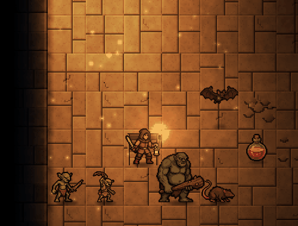

# Shadesdeep

A graphical roguelike played **inside the kitty terminal**: real RGBA pixel
art, per-pixel coloured lighting and smooth animation, presented through
kitty's graphics protocol. Brogue-style accessibility: full mouse support,
hover descriptions and clickable actions.



Version: 0.25.1 · Linux · needs [kitty](https://sw.kovidgoyal.net/kitty/)

How to play, in full: **[the player's manual](docs/MANUAL.md)**.

## Build and run

```sh
make              # builds build/shadesdeep and symlinks ./shadesdeep
./shadesdeep      # run inside kitty
```

Needs a C compiler (GNU C11), Make, pkg-config, and the libpng, zlib,
FreeType, SDL3 and libvorbis development packages
(`sudo pacman -S base-devel libpng zlib freetype2 sdl3 libvorbis`). SDL3 is only used for
sound, and libvorbis for the music; if no audio device opens, the game runs silent.

## Playing

- **The goal:** at the bottom of the dungeon, on depth 26, the Heartflame
  has gone cold. Carry fire down to it: walk into its hearth with a lit
  torch three times, while the Hollow (the great shade that put it
  out) tries to smother it. Win or lose, a closing screen sums up the run.
- **Sneak attacks:** any blow on a monster that hasn't noticed you (asleep,
  dazzled, or not hunting you) always lands, for triple damage. Sleepers stir
  as you come close, much less often in the dark or in a shadow cloak.
- **Traps and special rooms:** from depth 2, hidden alarm plates, draught
  vents, trapdoors and snares (a lit torch helps you spot them; known ones are
  marked and travel goes around them), and now and then a trapped storeroom,
  a guarded armoury or a shade's nest with a hoard of embers.
- **Hidden rooms:** some levels hide a room behind a secret door, with fine
  tempered gear, embers and supplies left in it. You may notice the door
  walking past or resting nearby; `s` (or the Search button) spends five turns
  searching the walls close by. Dead-end passages are a good place to look.
- **Wandering bands:** rats near the top, goblins (with a slinger, or an ogre
  at their head, deeper down) going from room to room. When one spots you, the
  whole band comes, and more arrive from the stairs now and then.
- **Five stretches of stone:** every five levels the dungeon changes: worn
  flagstones, then moss-grown works, red brick vaults, drowned slate and black
  basalt, each with its own room shapes (pillared halls, ruined rooms, ovals,
  crosses, rooms with their corners cut off).
- **Fire:** from depth 6 there's dry litter, stacked crates and casks of lamp
  oil, and fire spreads through them. Throw a torch into the straw under a
  sleeping goblin pack, or into a cask. Watch for spark plates.
- **Lakes and ruins:** from depth 2, wide lakes spread across rooms, corridors
  and the walls between them, and chasms are ragged holes where the floor has
  fallen in.
- **Mouse:** hover anything for a description; click to travel (the path is
  previewed), click a monster to attack it, click a cold sconce to walk over
  and light it, click yourself to rest. The wheel zooms. Descriptions fade
  after a few seconds, and pressing a key hides the hover marker until the
  mouse moves again.
- **Keys:** arrows / numpad / `h j k l y u b n` move and attack; `x` explore;
  `z` or `.` rest a turn, `Z` rest until healed, `s` search for hidden doors (explore and travel go round
  shallow water when there's a dry way); `>` travel to the stairs
  down and descend, `<` climb; `i` items, `t` throw, `a` / `q` use,
  `d` drop, `T` light or snuff your torch; `m` map; `+` / `-` zoom;
  F2 sound on/off, F3 music on/off; `?` help; Esc twice saves and quits.
- **Art:** the player, the creatures and the items are pixel art made with
  [SpriteCook](https://spritecook.ai). Every creature has an idle animation
  (breathing, a swaying lantern, a whirling sling, flapping wings), dust
  glitters in the torchlight, and at zoom 2 and up everything is drawn from the
  full-detail art so it stays sharp; `--classic-art` brings back the original
  built-in sprites. The buttons are slabs of worn, carved slate in the same
  chunky pixels, warming to firelight under the mouse.
- **Saving:** quitting (or closing the window) saves the game, and the next
  start carries on where you left off; it's also saved on every new level.
  Death (or winning) deletes the save. It lives in `~/.local/share/shadesdeep/save.gz`;
  `--new` starts afresh, `--save=FILE` and `--no-save` change or skip it.
- **Title and hall of fame:** the game opens on a title screen (Continue, New
  game, Hall of fame, Quit; `--no-title` skips it). A new game opens on a
  short prologue (any key begins). Every run that ends goes
  into the hall of fame, kept next to the save in `halloffame.txt`: how it
  ended, how deep you got, turns, embers, kills and the date, best first,
  with a gold mark on runs that slew the Hollow. A win ends on an epilogue
  telling what the rekindled fire did for the kingdom above.
  The closing screen tells you where the run stands, and
  `shadesdeep --hall-of-fame` prints the table in the terminal. A run log for balance
  tuning (`runlog.txt`, same folder) gets a line of stats on each new depth and
  at the end of each run.
- **Map:** `m` (or the Map button) shows the whole explored level, drawn
  with the game's own graphics: you, the stairs and any creatures you can make
  out are marked. Click a place on it to travel there.
- **Sound:** footsteps, splashes, steel, the creatures' voices, torches
  catching and hissing out, a low dungeon ambience, and crackling fire and
  lapping water that rise as you get near. Sounds are panned by where they
  happen and muffled out of sight. `--mute` starts silent, `--no-sound` never
  opens the audio device.
- **Music:** four synthesized pieces: harp, flute and choir for the title, a
  slow sarabande for the hall of fame, a tolling lament for a death, and timpani,
  brass, pealing bells and a hymn for a win. The dungeon itself has none, only
  its own sounds. F3 or `--no-music` turns it off.
- **Items:** every action has an on-screen button. Press Throw (or `t`) and
  your throwable items are listed; pick one, then aim with the mouse or the
  direction keys (Tab cycles visible monsters) and click or press Enter.
  Darts hit hard and can usually be picked up again; potions heal.
  - *Oil flask* (you start with one): thrown, it bursts into a pool of
    burning oil, even on water. It's a fixed fire, so shades can't bear it;
    nothing walks into it willingly, and it sears whatever stands in it. Or
    pour it over your torch's head for 50 more turns of light.
  - *Flash powder*: thrown, a blinding flash dazzles everything that sees it
    for a few turns (dazzled monsters can't act, lose track of you, and are
    hit for sure), scorches shades, and shows you the room. Water spoils it,
    and the bang wakes things further off.
  - *Salt*: pour a ring around you that no shade can cross. Anything else
    that walks through scuffs it away, you included.
  - *Warming draught*: drives out the chill at once, and for 80 turns no
    shade's touch can chill you.
- **Darkness:** some rooms start unlit. Lighting a sconce shows you the room,
  but anything in the light can see you too. In the dark, monsters only notice
  you when you are close.
- **Torches** are the clock, the way food is in other roguelikes: you find
  about three for every four levels, so light is precious. A lit torch lights
  a wide circle around you but burns out and makes you visible from afar.
  Lighting or snuffing it takes a turn, and snuffing wastes a little fuel.
  Throw one to light a room from a distance (it burns on the floor for a
  while), or to lure monsters with the noise. Walk onto a burning torch with
  your hand free to take it up again; one that burns out leaves a charred stub.
- **Shades** (from depth 2) are living darkness. They gather in unlit rooms,
  hunt you by your warmth whether you are lit or not, and in the dark you see
  only their eyes. They cannot enter firelight (the cold glow of crystals and
  moss doesn't count), but your carried torch only drives them off: they
  circle at the edge of its light and gnaw at the flame, so each one nearby
  burns an extra turn of fuel. Only a fixed fire burns them: a sconce lit
  while a shade is close (the sudden blaze holds it there until it burns
  away), or a torch thrown at it. Darts pass straight through. Their touch
  chills: it takes max HP (up to half) until you warm up by a lit sconce or a
  torch on the floor; a torch in hand warms you only slowly. Resting by a fire
  also heals faster.
- **More monsters:** *bats* (from depth 2) flit about twice a turn, come to
  the light from afar and fly over chasms and water; *goblin slingers* (depth
  3) sling stones from a distance, but only when they can see you in the
  light; *ogres* (depth 4) hit very hard but act only every other turn and
  can't be knocked back; *eels* lurk unseen in deep pools and bite anything in
  the water or on the bank beside them.
- **Gear** has no strength or skill requirements: anything you find, you can
  use, and each piece plays differently rather than simply being better.
  Open Items, pick a weapon or armour and press Wield / Wear (the old piece
  goes back in your pack). The item card shows its numbers next to yours.
  - *Short sword* (you start with it): steady, accurate, no tricks.
  - *Dagger*: its sneak attacks do five times the damage instead of three.
  - *Spear*: every thrust also hits whatever stands behind your target.
  - *Axe*: hits every foe around you, but is harder to aim.
  - *Mace*: knocks the foe back a step: into a wall for extra harm, into
    deep water, or over the edge of a chasm.
  - *Leather jerkin* (you start in it): some protection, no drawbacks.
  - *Shadow cloak*: little protection, but in the dark things must be close
    to notice you, and shades sense your warmth from half as far.
  - *Mail coat*: strong protection, but it jingles (waking sleepers nearby)
    and drags you under in deep water.
- **Embers and the forge:** lighting a cold sconce gives you an ember, and so
  does every shade that burns away. Each level has a forge brazier: walk into
  it to spend embers on tempering your weapon or armour (+1 each time: more
  accuracy and damage, or more armour), on +3 max HP, or on trimming your
  lantern so its own dim glow shows you more without giving you away.
  Tempering stays with the piece if you swap it out, and a hard fall down a
  chasm can blunt or buckle tempered gear. Deeper monsters hit a little
  harder, and gear found deeper is sometimes already tempered.
- **Water:** wading through the shallows splashes, and the noise carries.
  Deep water must be swum: it puts out (and ruins) a lit torch, so you are
  asked twice before swimming with one, and anything dropped in it sinks.
  Goblins won't follow you in, but eels may be waiting there. A torch thrown into water hisses out, and a
  chasm over water makes for a softer landing.
- **Chasms:** you can see the real level below through them. Stepping in asks
  whether to jump: it is a quick way down, but the fall hurts. Anything you
  throw into a chasm lands on the level below, and a burning torch keeps
  burning down there.

Text size follows kitty's own font size (ctrl+shift+= / -), or set `--text`.
The pixel zoom is picked from the window height; override it with `--zoom` or
`+` / `-`. `./shadesdeep --help` lists every option.

## Development

`./shadesdeep --dump out.png [--seed N] [--size WxH] [--cell H] [--steps N]` renders
a frame to PNG without a terminal. `SHADESDEEP_DUMP_CHASM=1` stands at the edge of a
chasm with the level revealed, `SHADESDEEP_DUMP_JUMP=N` jumps down N chasms, and
`SHADESDEEP_DUMP_LOWER=file.png` writes the rendered level below. `SHADESDEEP_DUMP_TORCH=1`
lights a torch, `SHADESDEEP_DUMP_MENU=inv|throw|use|item` opens a menu,
`SHADESDEEP_DUMP_AIM=dx,dy` aims a torch and `SHADESDEEP_DUMP_THROW=dx,dy,frac` freezes a
thrown torch part-way through its flight. `SHADESDEEP_DUMP_REST=N` waits N turns
first (e.g. to let a thrown torch burn out). `SHADESDEEP_DUMP_SHADE="dx,dy;dx,dy"`
puts shades near the player. `SHADESDEEP_DUMP_WATER=0|1|2` stands by a pool, in its
shallows, or swimming. `SHADESDEEP_DUMP_SPOT=0..4` stands in an east-west corridor
(with a rat and darts beside you), beside a door in a side wall, just north
of a room's south wall, or in front of a cold sconce with a shade two steps
away (4 also lights the sconce). It applies after `SHADESDEEP_DUMP_JUMP`. `SHADESDEEP_DUMP_MAP=1` opens the map and `SHADESDEEP_DUMP_HELP=1` the help.
`SHADESDEEP_DUMP_MOBS="bat,2,0;ogre,0,2"` puts creatures near the player (rat,
goblin, shade, bat, slinger, ogre, eel; `eel+` is an eel above the water).
`SHADESDEEP_DUMP_SENSED=1` makes every creature on the level hunt you as if it had just
attacked (eyes in the dark, arrows at the edge for off-screen ones).
`SHADESDEEP_DUMP_FORGE=N` stands by the forge with N embers and opens it (`N,0`
leaves it shut), `SHADESDEEP_DUMP_FRAMES=N[,FPS]` writes N more frames after the
first (`out-001.png` on, FPS a second, default 24: for checking animation), and `SHADESDEEP_DUMP_GEAR="spear,1;mail,0"` puts gear in the pack (`SHADESDEEP_DUMP_SLOT=N`
picks the item `SHADESDEEP_DUMP_MENU=item` shows). `SHADESDEEP_DUMP_TITLE=0|1|2` draws the
title screen (fresh, with a saved game, asking to give it up), with
`SHADESDEEP_DUMP_TITLEART=file.png` as its picture; `SHADESDEEP_DUMP_FAME=FILE[,RANK]` draws
the hall of fame in FILE with RANK picked out. `SHADESDEEP_DUMP_HP=N` sets your hit points
and `SHADESDEEP_DUMP_FAMEADD=FILE` writes a finished run into FILE (with
`SHADESDEEP_DUMP_MOBS="goblin,1,0"` and `SHADESDEEP_DUMP_REST=20`, a quick death to test with).
`SHADESDEEP_DUMP_INTRO=SECONDS` draws the prologue that long after it opened.
`SHADESDEEP_DUMP_SLAIN=1` counts the Hollow as slain by you (with `SHADESDEEP_DUMP_DEPTH=26
SHADESDEEP_DUMP_KINDLE=3`, the Hollow-slayer's ending).
`SHADESDEEP_DUMP_WADE=1` reports how many of the `--steps` tour's steps waded. A `~` after a creature's name in `SHADESDEEP_DUMP_MOBS` puts it there
asleep, `SHADESDEEP_DUMP_STRIKE=dx,dy[,N]` steps (attacks) that way N times, and
`SHADESDEEP_DUMP_WIELD=1` wields the last piece `SHADESDEEP_DUMP_GEAR` added.
`SHADESDEEP_DUMP_ROOM=store|armoury|nest|hidden` stands in such a room (`hidden-door`:
outside a hidden room's secret door, with the rest of the level shown),
`SHADESDEEP_DUMP_SEARCH=N` searches N times over, and `SHADESDEEP_DUMP_BANDS=1` reports
the wandering bands on the level.

The title picture is `assets/title.png`, any size (16:9 such as 1920x1080 is
best). It's scaled to cover the window, cropped evenly if the shapes differ,
with the bottom darkened for the menu. Without it the title is drawn: the
name over a fire's glow and rising sparks.

The sounds are synthesized by `tools/make_sounds.py` (Python 3 with numpy and
scipy) into `assets/sounds` (files already there are kept, so sounds you swapped in survive; `--only
NAME...` re-renders just those, `--force` re-renders everything); `assets/sounds/sounds.txt` says which file(s)
each event plays and how loud, and is only written when missing, so edit it
freely. `python3 tools/make_sounds.py --only step door` re-renders just those.

The music is composed and synthesized by `tools/make_music.py` (the same
Python, plus ffmpeg to write Ogg Vorbis; without ffmpeg, or with `--wav`, it
writes WAV, which the game also reads). It keeps existing files too; `--only
title fame death victory` picks pieces, `--force` redoes all four. Rendering
takes about a minute. Swap in your own music by replacing
`assets/sounds/music_*.ogg` or pointing the `*_music` lines in `sounds.txt` at
other `.ogg` or `.wav` files.

The creature sprites are `assets/sprites/NAME.png` (32x32, feet at the bottom,
facing right), each with an optional `NAME_glow.png` of the pixels that glow in
the dark; a creature without a file, or with one of the wrong size, falls back
to its procedural sprite in `src/tiles.c`. `NAME_hi.png` (and `NAME_hi_glow.png`)
is the same creature at full resolution on a square canvas laid out like the
32x32 one: at zoom 2 and up, `render_hires` draws it straight onto the zoomed
screen wherever the small sprite is still what shows, so walls in front keep
covering it and glows and shadows drawn over it are put back on top.
`NAME_anim.png` and `NAME_hi_anim.png` (with `_glow` strips) are an idle
animation, its frames side by side. Items are `item_NAME.png` with `_glow`,
`_hi` and `_hi_glow` in the same way; the menus draw their icons from the
`_hi` ones. All of them are sliced from the SpriteCook art in
`art/spritecook/` (`creatures-1.png`, `items-1.png` and the animation strips
in `anim/`) by `tools/slice_sprites.py` (Python 3 with Pillow and numpy:
`python3 tools/slice_sprites.py art/spritecook/creatures-1.png assets/sprites`),
which crops, mirrors and scales each picture, lines every animation frame up on
its still, keeps the eyes, and adds a dark rim; `spritecook-assets.json` records
the SpriteCook asset ids. The floors, walls, shades and the Hollow are still
procedural (`src/tiles.c`, `src/render.c`). Fonts: Cinzel and Alegreya (SIL Open Font License, see
`assets/fonts/`).

## Licence

Shadesdeep is released under the [MIT License](LICENSE). The fonts in
`assets/fonts/` (Cinzel and Alegreya) are under the SIL Open Font License;
their licence texts are kept beside them.
